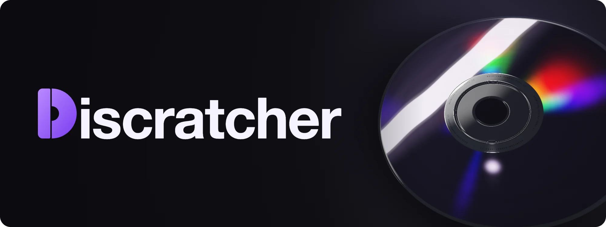
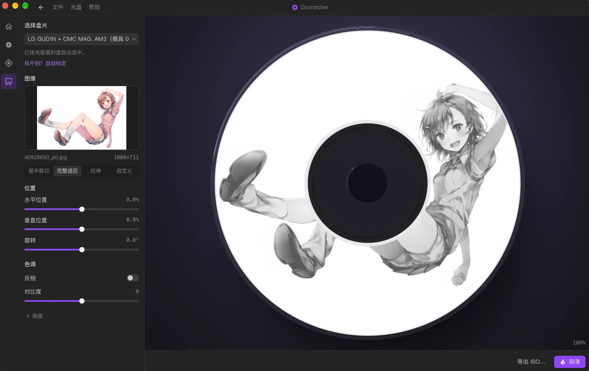
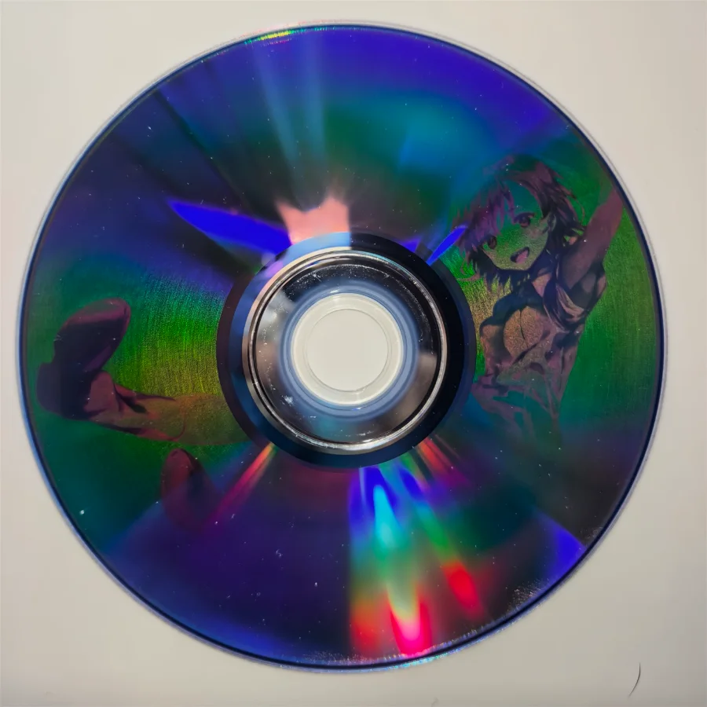
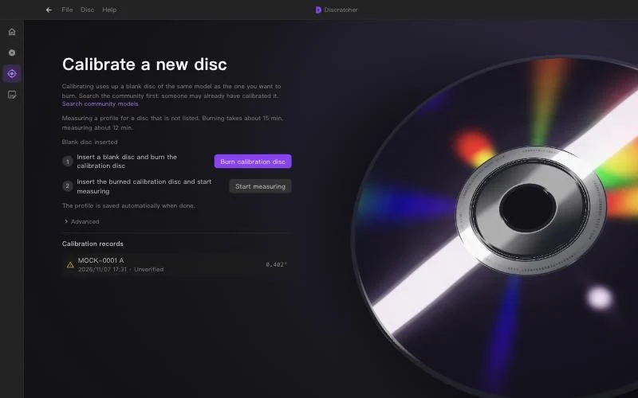
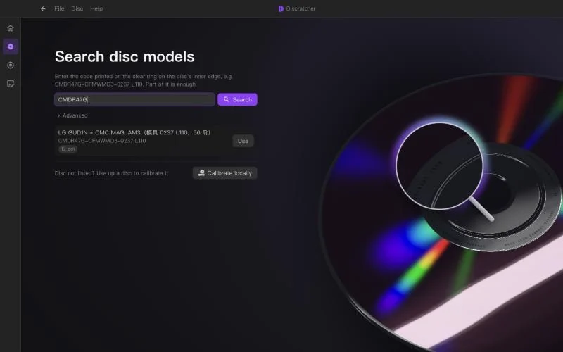
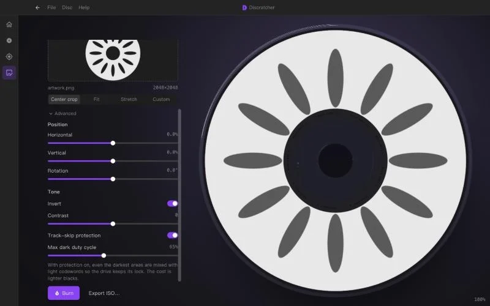

<p align="center">
  
</p>

<p align="center">
  <strong>Fully automatic calibration with a single disc, no photos needed | Use and contribute community calibration data | An improved algorithm for more successful burns</strong>
</p>

<p align="center">
  <a href="README.md">简体中文</a> | English
</p>

<p align="center">
  <a href="https://github.com/POPCORNBOOM/Discratcher/actions/workflows/ci.yml"></a>
  <a href="LICENSE"></a>
  
</p>

<p align="center">
  
  &nbsp;
  
</p>
<p align="center">
  <sub>Left: the preview in the app. Right: the result after a single automatic calibration.</sub>
</p>

## Features

<table>
  <tr>
    <td width="40%" valign="top">
      <h3>Automatic calibration</h3>
      <p>No manual measuring. The drive's own read timing reveals the disc's spiral geometry.</p>
    </td>
    <td width="60%"></td>
  </tr>
  <tr>
    <td width="40%" valign="top">
      <h3>Community calibration library</h3>
      <p>Enter the code printed on the disc's inner ring to download someone else's measurements, or share your own with people using the same disc.</p>
    </td>
    <td width="60%"></td>
  </tr>
  <tr>
    <td width="40%" valign="top">
      <h3>Drive protection</h3>
      <p>Caps the share of dark bytes and breaks up runs of them, so the drive does not lose tracking mid-burn.</p>
    </td>
    <td width="60%"></td>
  </tr>
</table>

The core logic does not depend on a window framework, and drive access is implemented per platform, so Discratcher is cross-platform.

## Quick start

1. Find your disc: enter the code printed on its inner ring and download the calibration.
2. Pick an image and press burn.
3. If your disc is not listed, calibrate it once (this uses up a disc), then share the result.

## Platform support

| Platform | Status |
| --- | --- |
| macOS + LG GUD1N | Tested |
| Other drives on macOS | Unverified |
| Windows 11 + LG GUD1N (USB) | Drive detection, burning and progress tested |
| Linux | Implemented, not tested on hardware |

## Build from source

```bash
pnpm install
pnpm tauri dev    # desktop app
pnpm dev          # UI only, with drive commands mocked
pnpm tauri build
cargo test -p disc-core --release
```

The core logic lives in `crates/disc-core` and does not depend on Tauri; `src-tauri` is only a command shell.

## Calibration library

Calibration data is the set of issues labelled `calibration` in this repository. The app reads them directly, with no account needed.

- **Contribute**: you must burn a real disc with your calibration before sharing it. The app opens a pre-filled issue form, you confirm the submission on GitHub, and the app stores no token. You can drop the source image and a photo of the result into the form.
- **Rate**: after burning with someone else's calibration, you can give it 1–5 stars, also through a pre-filled issue (label `rating`). Only an account's latest vote on each calibration counts.
- **Review**: adding the `verified` label removes the "unverified" badge in the app; closing the issue withdraws the calibration.

## Translation

UI text lives in `src/i18n/locales/`, one JSON file per language. Simplified Chinese and English are available today.

To add a language, copy `zh-CN.json`, rename it to the language code (for example `ja.json`), set `_name` to the language's own name, and translate the other values. The file then appears under Help → Language, and missing entries fall back to Simplified Chinese. Code reads text with `t('key')`; keep placeholders such as `{name}` as they are.

## Technical notes

Discratcher exists to make calibration simpler for DVD-R image burning, with the same graphical app on macOS, Windows and Linux. The measuring method comes from the published approaches of [disc-probe](https://github.com/Ashley-QwQ/disc-probe) and [discprobe-macos](https://github.com/NaiveTomcat/discprobe-macos).

<details>
<summary><strong>Problems hit while measuring discs</strong></summary>

- On macOS, some USB drives (such as the LG GUD1N) reject the MMC interface and cannot be opened. The fallback loads SCSITaskLib directly.
- The default range covered only 3%–85% of the disc, leaving about 340,000 outer sectors unmeasured. The range is now 2%–96% (25.29–56.91 mm), and the outer tracks do show pitch distortion, about 2.9° peak to peak.
- Preset export fitted ideal constant-pitch points rather than measurements, so the cubic coefficient always stayed near 0. The fit now uses the measured unwrapped angles directly, lowering the whole-disc residual RMS from 0.715° to 0.402°.
- The default total sector count was 2,298,496, which is 3,392 more than a DVD-R's actual 2,295,104 and makes the outer diameter about 0.035 mm too large. It now holds the actual value.
- Burned discs with no file system could not be opened because the exclusive lock was unavailable (0xE00002D5). Reads now go through `/dev/rdiskN` with `F_NOCACHE`, which needs no exclusive access.

</details>

<details>
<summary><strong>Problems hit while burning images</strong></summary>

- Dark pixels were filled with continuous `0xA5`, which drives cannot sustain. With large black areas the laser stays at full duty cycle for too long, trips the write power calibration protection, and reports a write error at around 15%, ruining the disc.
- Inverting the background is not enough either. With thick black lines, 99.7% of a sector is continuous `0xA5`, so the drive loses the pre-groove tracking, writes bad blocks, and jumps 179 sectors ahead along the spiral. Sectors span different fractions of a turn on the inner and outer tracks, so after the jump the whole image twists by about 2.4 extra turns.
- The cap is 65% dark bytes by default with runs broken up; tests require runs of at most 3.

</details>

## References

- [discprobe-macos](https://github.com/NaiveTomcat/discprobe-macos): a probe that measures the disc spiral from drive read timing (GPLv3). Its public data serves as a test reference here.
- [disc-probe](https://github.com/Ashley-QwQ/disc-probe): the upstream of the project above.

## License

[MIT](LICENSE)
