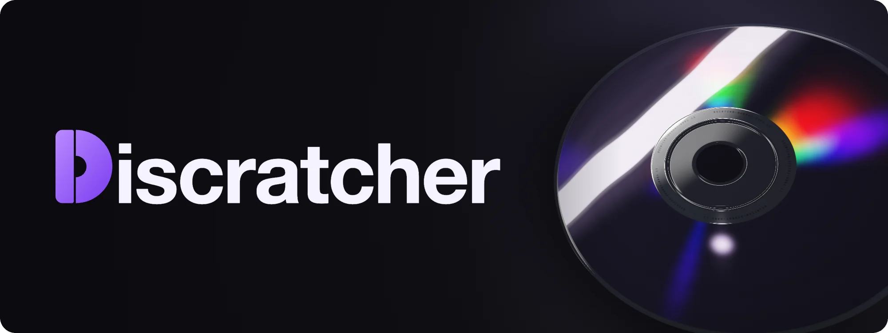
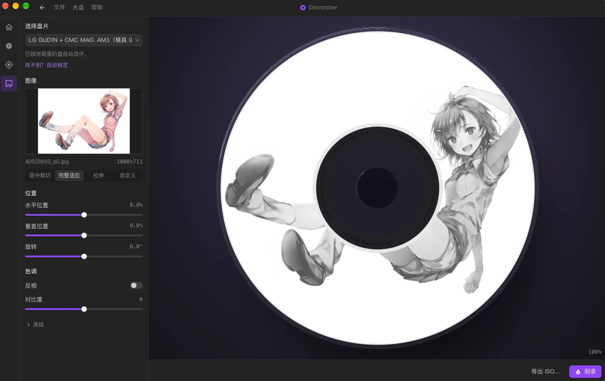
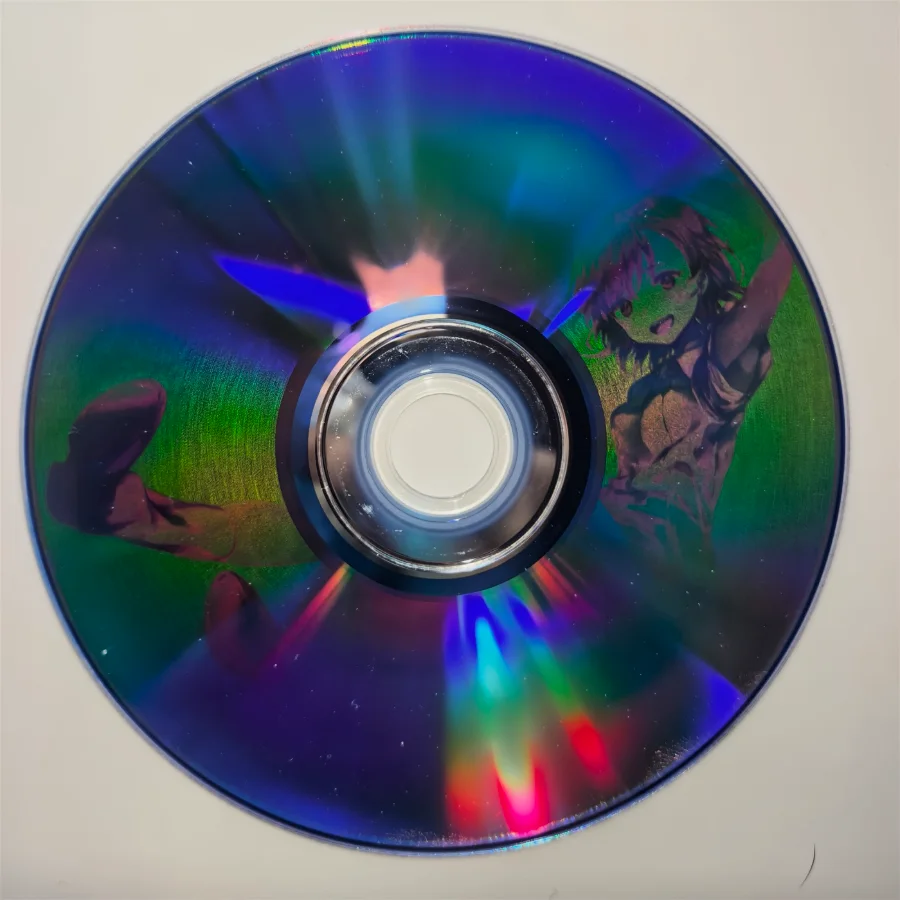
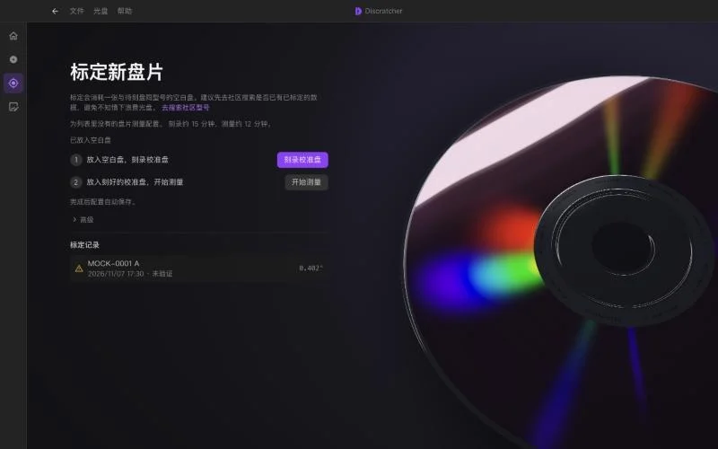
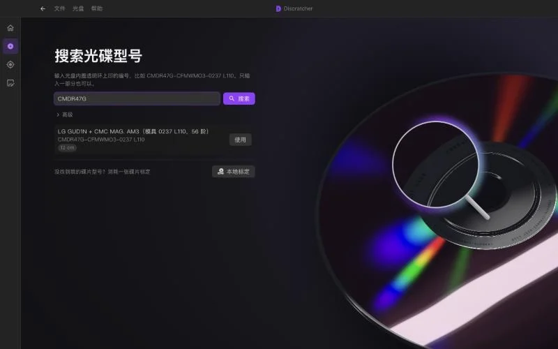
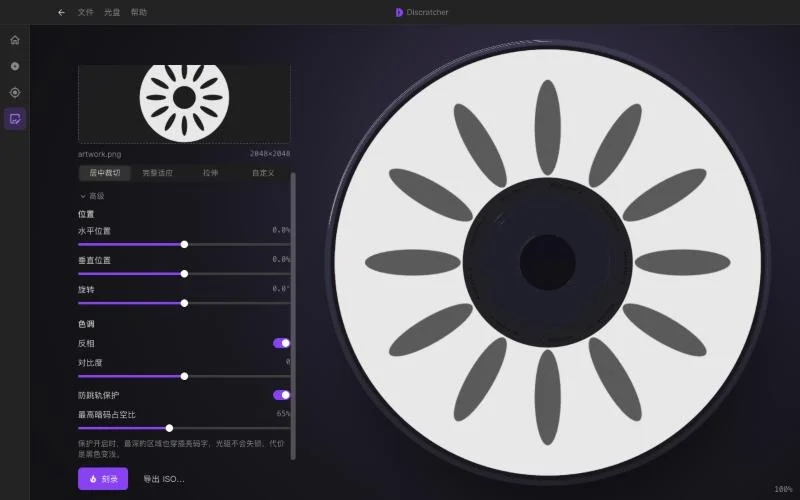

<p align="center">
  
</p>

<p align="center">
  <strong>无需拍照，一张光盘全自动标定光盘｜使用/贡献社区标定数据｜改进的算法提升刻录成功概率</strong>
</p>

<p align="center">
  简体中文 | <a href="README.en.md">English</a>
</p>

<p align="center">
  <a href="https://github.com/POPCORNBOOM/Discratcher/actions/workflows/ci.yml"></a>
  <a href="LICENSE"></a>
  
</p>

<p align="center">
  
  &nbsp;
  
</p>
<p align="center">
  <sub>左：软件里的预览。右：单次自动标定后刻录的结果。</sub>
</p>

> [!NOTE]
> Discratcher 还在早期阶段，目前**只支持 DVD 光盘**，暂不支持 CD 和蓝光。实测过的组合见下方[支持情况](#平台支持)，遇到问题欢迎[提 Issue](https://github.com/POPCORNBOOM/Discratcher/issues)。想在 CD 上刻图可以先用 [DiscImageStudio](https://github.com/JiaFeiMiao-K-Cat/DiscImageStudio)。

## 特性

<table>
  <tr>
    <td width="40%" valign="top">
      <h3>自动标定</h3>
      <p>无需手工测量，基于光驱的读取时序测定光盘的螺旋几何。</p>
    </td>
    <td width="60%"></td>
  </tr>
  <tr>
    <td width="40%" valign="top">
      <h3>社区标定库</h3>
      <p>输入光盘内圈印制的编号即可下载社区标定数据，也可以把自己的标定结果分享给使用同型号光盘的用户。</p>
    </td>
    <td width="60%"></td>
  </tr>
  <tr>
    <td width="40%" valign="top">
      <h3>保护光驱</h3>
      <p>限制暗字节占比并打散连续的暗字节，避免刻录过程中丢失寻迹。</p>
    </td>
    <td width="60%"></td>
  </tr>
</table>

核心逻辑不依赖窗口框架，光驱接入按平台分开实现，所以能跨平台。

## 快速开始

1. 查找光盘：输入内圈印制的编号，下载标定数据。
2. 选择图片，开始刻录。
3. 未收录的盘型需要标定一次（会消耗一张光盘），完成后可以分享结果。

## 更新

应用启动后会检查新版本，也可以在「帮助 → 检查更新」手动检查。更新包经过签名校验，安装后自动重启。Linux 只有 AppImage 版本支持应用内更新。

## 平台支持

| 平台 | 状态 |
| --- | --- |
| macOS + LG GUD1N | 已实测 |
| 其他 macOS 光驱 | 未验证 |
| Windows 11 + LG GUD1N | 已实测 |
| Linux | 代码已写，未经真机验证 |

| 光盘 | 状态 |
| --- | --- |
| DVD-R | 已实测（CMC MAG. AM3） |
| DVD+R、DVD-RW | 应该可用，未验证 |
| CD-R、CD-RW | 暂不支持：标定和刻图都按 DVD 规格计算 |
| 蓝光、DVD-RAM、双层 DVD | 暂不支持 |

## 从源码构建

```bash
pnpm install
pnpm tauri dev    # 桌面应用
pnpm dev          # 只开界面，光驱相关命令用 mock 代替
pnpm tauri build
cargo test -p disc-core --release
```

核心逻辑在 `crates/disc-core`，不依赖 Tauri；`src-tauri` 只是命令外壳。

## 标定库

标定数据来自本仓库带 `calibration` 标签的 Issue。Issue 变化时，工作流会把它们发布到 `catalog` 分支，应用读取这个文件，不需要账号。

- **贡献**：标定参数须先完成一次实际刻录才能分享。应用会打开填好的 Issue 表单，提交由你在 GitHub 上确认，应用不存任何 token。表单里可以拖入原图和效果图。
- **评分**：用别人的标定刻完后可以打 1–5 星，同样是一个预填的 Issue（标签 `rating`）。每个账号对每份标定只算最后一票。
- **审核**：给 Issue 加 `verified` 标签后，几分钟内就能搜到；关掉 Issue 就下架。

## 翻译

界面文案在 `src/i18n/locales/`，一个语言一个 JSON 文件，目前有简体中文和英文。

要加一种语言：复制 `zh-CN.json`，改名为语言代码（比如 `ja.json`），把 `_name` 改成这种语言的自称，再翻译其余的值。文件放进去就会出现在「帮助 → 语言」里，缺的条目会回退到简体中文。代码里用 `t('key')` 取文案，`{name}` 这样的占位符保持原样。

## 技术笔记

Discratcher 的目标是让 DVD-R 刻图的标定更简单，并在 macOS、Windows 和 Linux 上提供统一的图形界面。测量原理来自 [disc-probe](https://github.com/Ashley-QwQ/disc-probe) 和 [discprobe-macos](https://github.com/NaiveTomcat/discprobe-macos) 公开的做法。

<details>
<summary><strong>测光盘时踩到的问题</strong></summary>

- 部分 USB 光驱（如 LG GUD1N）在 macOS 上拒绝 MMC 接口，导致设备无法打开。现在回退到 SCSITask 用户客户端接口。
- 原默认测量范围仅为盘面的 3%–85%，最外圈约 34 万个扇区未被覆盖。范围已扩大到 2%–96%（25.29–56.91 mm），并确认恒定轨距模型的残差在 44 mm 以外峰峰值约 2.9°，内圈 25–31 mm 也有约 2.0° 的起伏（一次 56 阶实测，同一台光驱和同一张盘）。
- 原导出流程拟合的是理想恒定轨距点而非实测点，导致三次系数始终接近 0。现在直接拟合实测解包裹角，整盘残差 RMS 从 0.715° 降至 0.402°。
- 原默认总扇区数为 2,298,496，比 DVD-R 实际的 2,295,104 多 3,392，使外径偏大约 0.035 mm。已修正为实际值。
- 已刻录且没有文件系统的光盘，会因无法取得独占锁而打开失败（0xE00002D5）。现在改读 `/dev/rdiskN` 并启用 `F_NOCACHE`，无需独占访问。

</details>

<details>
<summary><strong>刻图时踩到的问题</strong></summary>

- 暗像素以连续的 `0xA5` 填充时，光驱无法稳定写入。原图含大面积黑色时，激光长时间处于满占空比，触发写入功率校准保护，在进度约 15% 时报写入错误，光盘随之报废。
- 反转底色不够用。线条较粗时，单个扇区内连续 `0xA5` 的占比可达 99.7%，光驱会丢失预刻槽寻迹并写出坏块，同时沿螺旋轨道向前跳过 179 个扇区。由于内外圈每扇区对应的圈数不同，跳轨后整幅图像会额外扭转约 2.4 圈。
- 暗字节占比现在有上限（默认 65%），连续的暗字节会被打散，测试要求最长连续不超过 3 个。

</details>

## 前人工作与致谢

用读取计时测扇区角度并不是这里首创。[disc-probe](https://github.com/Ashley-QwQ/disc-probe) 的致谢整理了更早的工作：

- 光盘防拷里的 DPM（Data Position Measurement）；
- redump 论坛 2025 年关于用 FUA 重读同一扇区测一整圈时间的讨论；
- 飞利浦专利 US7538787B2《在光盘上写入标签的方法》。

本项目建立在这些开源工作之上：

- [disc-probe](https://github.com/Ashley-QwQ/disc-probe)（GPL-3.0-or-later）：读取计时标定的开源实现。Discratcher 的逐级测量、主轴稳定判断和部分常量参考了它的实现。
- [discprobe-macos](https://github.com/NaiveTomcat/discprobe-macos)（GPLv3）：disc-probe 的 macOS 移植。它的公开数据用作本项目的测试对照。
- [DiscImageStudio](https://github.com/JiaFeiMiao-K-Cat/DiscImageStudio)（GPL-3.0-or-later）：数据面刻图的螺旋模型和编码参考了它。

感谢这些项目的作者，也感谢向它们报告实测结果的用户。

## 许可

Copyright (C) 2026 Yigu Wang

本程序是自由软件：你可以按照自由软件基金会发布的 GNU 通用公共许可证（第 3 版，或任何更新的版本）重新发布和修改它。发布本程序是希望它有用，但不提供任何担保，包括适销性或特定用途适用性的隐含担保。详见 [LICENSE](LICENSE) 和 [NOTICE](NOTICE)。SPDX：`GPL-3.0-or-later`。
